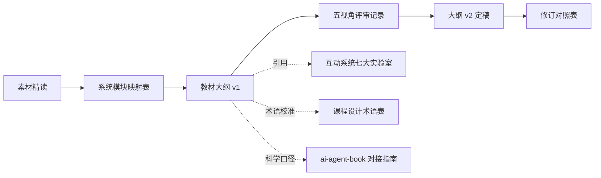

## User Requirements

在新建的教材目录中，依据现有《AI智能体互动教学系统（静态版）》，编写一本面向五~六年级学生的《AI智能体科普实践课》学生用书。本轮任务为**先出教材大纲，并进行多视角评审与迭代修订**，暂不撰写正文。

## Product Overview

教材定位为学生人手一册的图文读本，语言儿童化、任务驱动，采用「情境导入 → 知识讲解 → 动手任务 → 小挑战 → 小结」的统一体例。全书以互动教学系统的「封面 + 七大实验室」为主线组织章节：导论（如何用这本书）→ 第 1 章 起源（AI 从哪里来 · 身边的智能体）→ 第 2 章 架构（智能体总装图）→ 第 3 章 感知器 → 第 4 章 规划器 → 第 5 章 记忆器 → 第 6 章 执行器 → 第 7 章 综合实战与上线 → 结语。每节需与系统里的具体实验室、卡片、实验逐一对应，使教材可同时当作"上机操作手册"使用；动手任务挂靠课程双作品主线「班级小管家」与「天气小管家」。

## Core Features

- **大纲框架**：完整章 / 节层级，逐节标注学习目标、对应互动系统模块与卡片、动手任务、安全与责任提示、建议课时与配图。
- **模块映射底表**：把七大实验室的全部模块，逐条映射到教材章节，确保无遗漏、无重复。
- **术语与口径统一**：学生正文术语与《课程设计》§0 术语表一致，科学口径与《ai-agent-book》对接指南一致，教师科学储备内容不进学生正文。
- **降级与安全说明**：凡涉及联网 / API Key 的实验，均写明"未配置或断网时的降级方案"，保证课堂不中断。
- **多视角评审与迭代**：按教学法、学科科学、一线课堂、学生认知、编辑体例五个视角出具问题清单（含严重度与修订动作），并产出修订版大纲与 v1→v2 修订对照表。

## Tech Stack Selection

- **文档形态**：Markdown 分文件编写，便于版本化、评审留痕与后续转换为 Word / PDF。
- **产出目录**：`c:/Users/Lewes/Desktop/AgentTeaching` 下新建 `AI智能体科普实践课_学生教材/`（仅新建，不修改或移动任何现有素材文件）。
- **依据素材（只读引用）**：`AI智能体互动教学系统_静态版/README.md`（七大板块模块清单）、`AI智能体科普实践课_课程大纲.md`（v3.0）、`AI智能体科普实践课_课程设计.md`（§0 术语表）、`教案/` 16 份、`AI智能体科普实践课_ai-agent-book对接指南.md`、`课程整体介绍.md`。
- **配图来源**：`images/` 与开源书 `ai-agent-book/`（Apache-2.0，需标注来源与许可）。

## Implementation Approach

采用"抽取映射 → 起草大纲 → 多视角评审 → 迭代定稿"的四步策略：

1. 先精读互动系统 README 与各实验室文案、课程大纲、教案与对接指南，产出一张可核查的"系统模块 ↔ 教材章节"映射底表（作为大纲的骨架，保证逐模块对应、无遗漏）。
2. 以映射表为骨架，按统一体例起草教材大纲 v1（章 / 节 / 学习目标 / 系统模块对应 / 动手任务 / 安全提示 / 建议课时 / 配图）。
3. 以五视角评审（教学法、学科科学、一线课堂、学生认知、编辑体例）逐节挑错，形成含严重度与修订动作的问题清单。
4. 按清单逐条落地，产出大纲 v2 与 v1→v2 修订对照表，确保修订可追溯。

**关键决策与理由**：

- 以"系统模块映射表"而非"16 课次序"作为骨架，因为用户已选定按七大实验室组织，且需保证教材与系统逐模块对应。
- 评审采用五视角并行，避免单一视角漏检（科学性、可教性、可上机性、可读性四个维度全覆盖）。
- 年级口径统一为五~六年级（覆盖原四年级与五年级两套说法），正文标准写作并预留「想一想 / 挑战」分层拓展。

**性能与可靠性**：本任务为文档工程，无运行时性能问题；重点在于映射完备性（避免章节与系统脱节）与修订可追溯性（每条评审意见对应到具体修订动作）。

## Implementation Notes

- **只读引用**：`Agent教学/` 下已有大量素材，教材目录单独新建，不覆盖、不移动、不改名任何既有文件。
- **口径一致性**：学生正文术语一律以《课程设计》§0 术语表为准；疑难处对照《ai-agent-book 对接指南》的术语对照表校准，避免"儿童化讲法讲错"。
- **降级标注**：语音识别、图片识别、思维链实验、联网搜索、天气查询等依赖联网或 Key 的功能，在对应小节均须写明降级路径与"示例演示"兜底。
- **体例统一**：全书固定五段式（情境导入 / 知识讲解 / 动手任务 / 小挑战 / 小结），并在导论中给出图例说明（四大组件语义色：感知蓝 / 规划橙 / 记忆绿 / 执行红 + 大脑金）。
- **许可合规**：引用 `ai-agent-book` 图件时标注来源与 Apache-2.0 许可，正文不引入 Git / API / KV Cache 等技术细节。

## Architecture Design

文档组织与评审迭代关系如下：



## Directory Structure

在 `Agent教学/AI智能体科普实践课_学生教材/` 下新建，结构如下：

```
AI智能体科普实践课_学生教材/
├── README.md                    # [NEW] 目录说明与写作约定。包含：本目录用途、教材定位（学生用书/五~六年级）、全书五段式体例、图例与语义色约定、术语口径来源（课程设计 §0）、素材来源与 ai-agent-book 许可说明、后续正文写作与命名规范指引。
├── 00_素材与模块映射表.md        # [NEW] 大纲骨架。逐条列出互动系统七大板块（封面 + 起源/架构/感知/规划/记忆/执行/智能体实验室）的全部模块（卡片/实验/游戏/小测验/进阶课堂概念），映射到教材章节与节次，标注覆盖课次 L01–L16，确保无遗漏、无重复。
├── 01_教材大纲_v1.md            # [NEW] 教材大纲初稿。按导论 + 第 1–7 章 + 结语组织；每节给出：学习目标、对应互动系统模块与操作步骤（打开哪个实验室、点亮哪张卡片、做什么实验）、动手任务（挂靠班级小管家/天气小管家）、安全与责任提示、懒加载/降级说明、建议课时与配图建议；含作品里程碑 M0–M4 与双作品主线贯穿说明。
├── 02_评审记录.md               # [NEW] 多视角评审。按教学法、学科科学、一线课堂、学生认知、编辑体例五个视角，逐条列出问题（含位置、问题描述、严重度高中低、修改建议、对应修订动作），并给出整体评审结论。
├── 03_教材大纲_v2.md            # [NEW] 评审修订后的大纲定稿，体例与 v1 一致，落实全部高优先级修订，并标明本轮修改点。
└── 04_修订对照表.md             # [NEW] v1→v2 逐条修订对照。以表格记录：评审意见编号、原文位置、v1 写法、v2 写法、修订理由，保证迭代可追溯。
```

## Agent Extensions

### Skill

- **light-file-reading**
- Purpose: 精读互动教学系统 README 与各实验室文案、16 份教案、课程大纲 v3.0、课程设计与 ai-agent-book 对接指南，抽取模块清单、术语口径与安全提示。
- Expected outcome: 产出准确、可核查的"系统模块 ↔ 教材章节"映射底表，并汇总术语与降级规则清单。
- **light-project-structure**
- Purpose: 建立教材新目录与文件命名规范，编写 README（用途、体例约定、素材与许可说明）。
- Expected outcome: 结构清晰、命名规范、版本可追踪的教材目录与写作约定文档。
- **light-paper-drafting**
- Purpose: 以 outline-only 模式撰写教材大纲 v1，并按其体例完成 v2 修订。
- Expected outcome: 章 / 节 / 学习目标 / 系统对应 / 动手任务 / 安全提示 / 课时齐备的完整大纲。
- **light-review-rebuttal**
- Purpose: 从教学法、学科科学、一线课堂、学生认知、编辑体例五个视角对大纲做严格评审。
- Expected outcome: 含位置、严重度与修订动作的问题清单及评审结论。
- **light-consistency**
- Purpose: 统一全书术语、组件语义色、作品名称与里程碑口径，确保章节间与互动系统表述一致。
- Expected outcome: 术语表与口径对照，消除前后不一致。
- **light-self-review**
- Purpose: 收尾自审，检查大纲逻辑完整性、映射无遗漏、修订对照可追溯与格式规范。
- Expected outcome: 自审报告与最终缺陷修复，输出可交付的大纲 v2 与对照表。