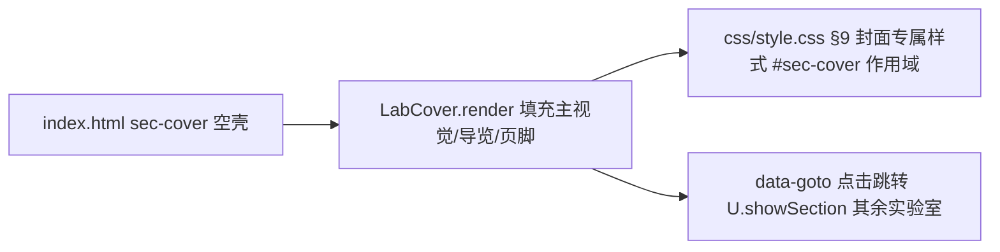

## 产品概述

对「AI智能体互动学习实验室」的封面页（`#sec-cover`）按苹果官网设计规范重新设计：美观、简约、大留白。

## 用户已确认的取舍

- 内容从 6 大块精简为 3 部分：主视觉、七实验室导览、页脚一行小字提示。
- 删除：四大组件环形图、课程地图 4 卡、使用提示 4 卡、彩色核心公式条组件。
- 配色：封面专属纯白风（近白底、深灰文字、超大字号，类 apple.com/cn），其余实验室页面保持现有暖米白主题不变。
- 主视觉保留：课程徽章、功能标签行（5 个胶囊）、大标题 + 一句话副标题 + **单个**主按钮（苹果蓝）。
- 原「核心公式」口径压缩为导览区上方一行灰字过渡句；原 4 条使用提示合并为页脚一行小字（浏览器建议 / API Key 说明 / 密钥仅存本机）。
- 交互保留：7 张实验室卡片与主按钮点击后 `U.showSection()` 跳转不变。

## 视觉效果

打开封面即是一屏大标题居中的纯白主视觉；下滑进入浅灰底导览区，7 张白色圆角卡片（第 7 张「智能体实验室」跨两列做深色强调收尾）；页面底部一行灰色小字；整页层次干净、留白充足。

## 技术栈

沿用项目现有纯静态方案（原生 JS + 单一 style.css），不引入新依赖。

## 实现方案

- **只改两个文件**：`js/lab-cover.js`（渲染结构）与 `css/style.css`（§9 封面样式重写）。
- `js/lab-cover.js`：删除 `ERAS`/`RING`/`NOTES` 三个数据数组；`LABS` 保留但 `desc` 精简为一句话（≤24 字）；`render()` 重组为「主视觉 → 导览区（含一行灰字过渡句）→ 页脚提示」；`bind()` 的 `[data-goto]` 绑定原样保留。
- `css/style.css`：重写 §9（约 7225–7341 行）。纯白风通过 `#sec-cover` 作用域选择器实现，不污染其他页面；删除环形图、课程地图、使用提示相关规则；保留 `.formula-strip` 基础样式与 `.formula-line .f-grp`（7229 行，被 `js/lab-home.js:197-203` 复用，不能删）。
- 响应式沿用现有断点（≤900px 两列变一列、≤560px 单列）。
- 关键细节：大标题 `clamp(40px, 6.5vw, 68px)`、字重 700、负字距；区块垂直间距 96–120px；`showSection()` 切页会 `scrollTo(0)`，无需额外处理。

## 架构

## 设计风格：Apple 官网极简风（封面专属）

- **主视觉**：近纯白底（#fbfbfd）满屏居中；顶部细边框浅灰课程徽章；超大深灰标题（#1d1d1f，clamp 40–68px，负字距）；一行 #6e6e73 副标题；单个苹果蓝 #0071e3 胶囊主按钮「开始探索 · 起源实验室」；下方 5 个细边框浅灰功能胶囊标签。整区上下留白约 96–120px。
- **导览区**：#f5f5f7 浅灰分区底，白色 18px 圆角卡片 2 列网格（≤900px 一列）；卡片仅含语义色图标 + 实验室名 + 课程号小字 + 一句话简介 + 细箭头，悬停轻微上浮；第 7 张「智能体实验室」跨两列、深灰底白字做强调收尾；区块标题上方一行灰字过渡句「AI Agent = 大脑 + 眼睛 + 小本子 + 手 —— 七个实验室，带你逐个拆开看」。
- **页脚**：一行居中灰色 12px 小字（浏览器建议 · API Key 说明 · 密钥仅存本机）。
- 全部使用项目现有 PingFang SC 字体栈与图标组件 `U.icon`，不新增字体与库。

## Agent Extensions

### Skill

- **light-frontend-design**
- Purpose：指导封面页苹果风重设计的视觉实现（留白节奏、字号阶梯、卡片层次、悬停动效）
- Expected outcome：封面达到苹果官网级的简约美感，且与站内其余页面风格隔离
- **agent-browser**
- Purpose：启动本地服务后在真实浏览器中验证新封面（桌面/窄屏截图、7 张卡片跳转、封面↔实验室往返）
- Expected outcome：桌面与 ≤900/≤560px 断点均美观无错位，跳转与导航正常，其他实验室页面外观不受影响