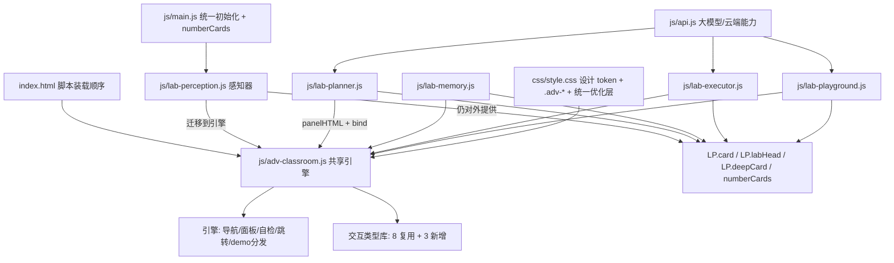

## 需求概述

以「感知器实验室」为标杆，对**规划器、记忆器、执行器、智能体实验室**四个板块做同等级别的迭代优化与完善（起源、总装图留待第二批）。核心是把感知器的两个能力复制过去：**可自动判定的动手交互**，以及**进阶原理互动课堂**。

## 功能内容

1. **进阶原理全部升级为互动课堂**：四个板块现有的静态术语网格（规划器 10、记忆器 10、执行器 10、智能体实验室 5，合计 **35 个概念**）逐条补齐六层内容——一句话讲明白 / 打个比方 / 真实 AI 系统里是这样 / 一个可动手的互动演示 / 自检一问（点击展开答案）/ 一键跳回本页对应实验并高亮。
2. **每个板块新增 4~5 个可自动判定的动手实验卡**（只新增、不改动现有卡片）：

- 规划器：任务分解树、步骤依赖与并行排序、计划自检（反思）、以及"清晰的任务描述四要素"可判定对比实验；
- 记忆器：RAG 检索命中可视化、写入与遗忘开关、隐私脱敏判定、上下文预算分配；
- 执行器：Function Calling 参数组装器、工具描述质量调参、工具幻觉防线拦截、多工具链式调用预测；
- 智能体实验室：管线阶段预测、组件开关对回答质量的影响。

3. **补齐智能体实验室缺失的教学结构**：学习目标卡、课堂小结卡、小测验卡。
4. **真实 AI 对比实验**：允许调用 DeepSeek，但**必须实现无 Key / 无网络时自动降级为内置示例演示**，并明确标注"示例演示"，保证课堂不中断。
5. **一致性**：四个板块的卡片编号、来源注、页头胶囊、进阶课堂结构、术语口径保持全站统一。

## 视觉与交互效果

沿用现有设计语言（暖米白底、四大组件语义色、圆角卡片、序号徽章）。新增交互沿用感知器已建立的视觉范式：左侧概念导航 + 右侧讲解面板、选项按钮的答对/答错动画、暗底代码框、进度条与滑条、达标检查表。所有可点元素有 hover 与键盘焦点态，窄屏下自动堆叠，尊重系统"减少动态效果"设置。

## 边界与约束

- 纯静态站点，**双击 `file://` 打开必须继续可用**，不引入构建工具、npm 依赖或网络字体；
- **现有卡片内容一张不改**（新增内容一律放在新增卡片里），仅"进阶原理"卡按用户确认替换为互动课堂；
- 无 Key 降级路径、离线可用、中文系统字体、大屏投影可读性（正文对比度 ≥4.5:1）全部保持。

## 技术栈

- **前端框架**：无框架，原生 HTML + CSS + ES5 风格 JavaScript（与现有代码一致，保证 `file://` 直接可用）
- **样式**：手写 CSS，复用 `css/style.css` 顶部 `:root` 设计 token（颜色/间距/圆角/字号/动效/层级）与文件末尾「统一优化层」
- **共享层**：新增一个共享脚本 `js/adv-classroom.js`，挂载到全局 `AgentLab.Adv`
- **验证工具**：Node（`node --check` 语法检查）、Python 静态服务器、agent-browser（Chromium 端到端点击验证与截图）

## 实施方案

### 核心决策一：把感知器的「进阶课堂」抽成共享引擎，而不是复制四份

感知器现有的互动课堂（导航 / 面板 / 自检 / 跳转 / 8 个交互演示）代码与其内容数据强耦合在 `js/lab-perception.js` 内（约 1891-2771 行）。若给四个板块各复制一份，将新增约 4000 行重复代码，后续无法统一维护。因此：

1. 新建 `js/adv-classroom.js`，把**引擎**（导航与面板渲染、自检问答、跳转高亮、demo 分发、事件绑定）与**可复用的交互类型**（渲染 + 绑定）下沉到这里，做成**完全数据驱动**；
2. 各板块只提供**数据**（概念内容 + 交互类型的数据表），代码零复制；
3. 感知器自身也迁移到该引擎（行为与外观保持不变），以此作为"引擎可用"的回归基准。

**依赖方向（关键）**：`adv-classroom.js` 只依赖 `AgentLab.UI`（`U.$ / U.icon / U.esc / U.toast / U.celebrate`），**绝不反向依赖 lab 文件**；卡片外壳仍由各板块调用现有的 `LP.card(...)` 生成，即 `LP.card(color, title, sub, AgentLab.Adv.panelHTML(opt))`，避免循环依赖。`index.html` 中该脚本插在 `js/agent.js` 之后、`js/lab-origin.js` 之前，确保所有 `lab-*.js` 都能使用。

### 核心决策二：交互类型做成"可复用模板 + 数据"，避免每板块重写交互

首批下沉的通用交互类型（感知器已在用、经验证可用）：

| 类型 id | 交互形态 | 可复用场景 |
| --- | --- | --- |
| `modality` | 多按钮切换 + 工序链 + 内置小测 | 模态/阶段转换演示 |
| `switchboard` | 多开关 + 快照 + 依赖判定 | 观察空间、记忆写入、组件开关 |
| `composer` | 消息池点选 + 规则校验 + 实时 JSON | 上下文组装、Function Calling 参数组装 |
| `calculator` | 输入 → 数值/费用/占比条 | Token 预算、上下文占用 |
| `vectorMap` | 二维坐标点 + 最近邻 Top3 | 向量空间、语义相似度 |
| `decider` | 两组选项 → 组合出推荐结论 | 路径决策、范式选择 |
| `sandbox` | 来源切换 + 防护开关 + 双输出对比 | 提示注入、隐私脱敏、幻觉拦截 |
| `squeezer` | 滑条 → 占用条 + 被挤出标红 | 上下文窗口、长对话遗忘 |


此外**新增 3 个类型**（四个板块的旗舰交互需要）：`pipeline`（多阶段管线播放、可预测可回放）、`sorter`（步骤排序 + 依赖/并行关系判定）、`tuner`（滑条调参 → 指标变化，如工具描述详细度影响选择准确率）。新增类型全部复用现有 `.adv-*` 视觉语言，仅在 `css/style.css` 追加必要类。

### 核心决策三：可判定反馈 + 示例降级，是每个新实验的硬要求

- 所有新交互必须**有对错判定与即时反馈**（复用 `.opt.correct/.opt.wrong`、`.fb-ok/.fb-no`、`U.addScore/U.celebrate`），不能是"点一下看动画"的被动演示；
- 涉及大模型的实验（规划器的"四要素对比"、执行器的"多工具链式调用"、智能体实验室的"组件开关"）统一采用**双通道**：有 Key 走 `AgentLab.API.chat/ask` 真实调用，无 Key 或调用失败时走内置示例对照并显示"示例演示（未配置 DeepSeek Key）"标签，同时把降级原因写进状态文字（沿用感知器 `runDemo(reason)` 的做法）；
- 复用感知器已有的可判定范式工具（`cmpSplit` / `cmpAnswerHTML` / `cmpAnalyze` / `cmpDrawTable`）思路，按板块需要下沉为通用"达标检查表"渲染器。

### 性能与可靠性

- 每个板块的互动课堂**懒渲染**：只渲染当前选中概念的 demo（切换时重建单个面板 `innerHTML` 并重新绑定），避免 35 个概念一次性生成大量 DOM；
- 事件绑定使用"容器委托 + 面板级重绑"，不做全站查询；避免 `innerHTML` 拼接中包含用户输入（一律经过 `U.esc`）；
- 交互状态保存在数据对象上（如开关的 `on` 字段），重渲染不丢状态；不引入定时器泄漏（沿用现有 `setTimeout/setInterval` 清理约定）；
- 不新增网络请求依赖；不改变现有 API 调用逻辑与错误提示映射。

## 架构设计



- **分层**：设计 token 层（CSS）→ 组件层（`LP.card/labHead` 卡片外壳）→ 交互引擎层（`AgentLab.Adv`）→ 内容数据层（各 lab 的 `ADV` 数据）→ 交互绑定层（各 lab 的 `bind*`）
- **数据流**：用户点击导航 → 引擎切换 `activeId` → 渲染该概念面板 → 绑定该 demo 事件 → 用户操作 → 本地判定/（可选）调用大模型 → 反馈与得分；"跳回实验"按钮通过 `closest('.card')` 定位目标卡片并 `scrollIntoView` + `.adv-flash` 高亮

## 目录结构

```
AI智能体互动教学系统_静态版/
├── index.html                     # [MODIFY] 在 js/agent.js 之后、js/lab-origin.js 之前插入一行：
│                                  #          <script src="js/adv-classroom.js"></script>
│                                  # 说明：必须早于所有 lab-*.js，晚于 ui.js/agent.js；不改动其他任何标签
├── js/
│   ├── adv-classroom.js           # [NEW] 共享交互引擎（约 900-1200 行）
│   │                              #  - AgentLab.Adv.panelHTML(opt)：返回 .adv-wrap 结构（左导航 + 右面板）
│   │                              #  - AgentLab.Adv.bind(root, opt)：绑定导航切换、自检展开、跳转高亮、demo 分发
│   │                              #  - 交互类型库：modality/switchboard/composer/calculator/vectorMap/
│   │                              #    decider/sandbox/squeezer（从感知器下沉）+ pipeline/sorter/tuner（新增）
│   │                              #  - 每个类型导出 { demoHTML(data), bind(root, data) } 两个纯函数
│   │                              #  - 内置"达标检查表"通用渲染器（下沉自 cmpDrawTable 的思路）
│   │                              #  - 降级约定：所有真实 AI 调用示例统一走 AgentLab.Adv.askOrDemo(...)
│   ├── lab-perception.js          # [MODIFY] 把 1891-2771 行的引擎与 8 个 demo 迁移到共享模块，
│   │                              #  仅保留感知器自己的 ADV 内容数据与 demo 数据表；
│   │                              #  deepCard 保留（其余 5 个 lab 仍会调用，第二批再升级）；
│   │                              #  导出保持不变并补充便捷方法，确保 main.js 与其它 lab 无感
│   ├── lab-planner.js             # [MODIFY] render() 尾部（第 347 行 deepCard 处）替换为进阶课堂卡片；
│   │                              #  新增 4 张实验卡；bind 列表（第 360-370 行）追加新交互绑定
│   ├── lab-memory.js              # [MODIFY] render() 第 307 行 deepCard 处替换为进阶课堂卡片；
│   │                              #  新增 4 张实验卡；bind 列表（第 321-325 行）追加绑定
│   ├── lab-executor.js            # [MODIFY] render() 第 319 行 deepCard 处替换为进阶课堂卡片；
│   │                              #  新增 4 张实验卡；bind 列表（第 333-336 行）追加绑定
│   ├── lab-playground.js          # [MODIFY] render()（第 47 行起）新增学习目标卡、小测验卡、课堂小结卡、
│   │                              #  2 张新交互卡；第 108 行 deepCard 替换为进阶课堂卡片；bind() 内追加绑定
│   └── main.js                    # [不变] numberCards() 已能自动为新增卡片编号
├── css/
│   └── style.css                  # [MODIFY] 末尾追加：pipeline / sorter / tuner 三个新交互类型的样式；
│                                  #  其余全部复用现有 .adv-* / .cmp-* / token，不新增色板
└── (其余文件与文档不动)
```

## 关键代码结构

共享引擎与各板块之间的契约（这是 5 个板块能共用一套引擎的前提）：

```javascript
/* 概念数据结构（每个板块提供 8~10 条） */
{
  id: "react",                 // 唯一 id，用于导航切换
  icon: "gear",                // 复用 AgentLab.UI.ICONS 中的图标名
  nav: "ReAct 循环",           // 左侧导航短名
  name: "ReAct 循环",          // 面板标题（中文）
  en: "REACT LOOP",            // 面板标题（英文小字）
  tip: "一句话讲明白……",       // 高亮条
  analogy: "打个比方……",      // 支持少量 HTML 标签（b）
  real: "真实 AI 系统里是这样……",
  demo: "pipeline",            // 交互类型 id
  demoData: { /* 该类型所需的数据表 */ },
  quiz: { q: "自检一问？", a: "参考答案" },
  links: [{ t: "去对应的实验动手", el: "元素 id（引擎用 closest('.card') 定位卡片）" }]
}

/* 引擎对外接口 */
AgentLab.Adv = {
  panelHTML: function (opt) { /* opt = { concepts: [...], activeId } → 返回 .adv-wrap HTML */ },
  bind: function (rootEl, opt) { /* 绑定导航/面板重渲染/自检/跳转/demo；opt.concepts 为同一份数据 */ },
  askOrDemo: function (opt) { /* opt = { messages|ask, demoText, onDemo } → 有 Key 走真实模型，否则返回示例并标注 */ },
  checklistHTML: function (rows) { /* 通用达标检查表：rows = [{n, av, bv, ae, be}] */ }
};

/* 每个交互类型导出两个纯函数，供引擎分发 */
AgentLab.Adv.types.pipeline = { demoHTML: function (data) {}, bind: function (rootEl, data) {} };
AgentLab.Adv.types.sorter   = { demoHTML: function (data) {}, bind: function (rootEl, data) {} };
AgentLab.Adv.types.tuner    = { demoHTML: function (data) {}, bind: function (rootEl, data) {} };
```

## 实施注意事项

- **回归第一**：迁移感知器引擎后，必须逐一点击感知器现有 8 个 demo（模态转换器 / 观察通道 / 上下文组装器 / Token 计价器 / 向量地图 / 路径决策器 / 污染沙盒 / 窗口挤压器），确认判定结果、得分、自检问答、跳转高亮与迁移前完全一致；
- **爆破半径控制**：`deepCard` 保留不动（`lab-home.js`、`lab-origin.js` 仍在调用）；不改 `LP.card` 的签名与渲染结果，避免已完成的"序号徽章 / 来源注"统一化被破坏；不改 `index.html` 既有标签；
- **`file://` 兼容**：不使用 ES6 模块（`import/export`）、不使用 `fetch` 加载本地 JSON，所有数据内联在脚本里；
- **文案一致性**：四个板块的进阶课堂文案统一口径（术语中英对照、难度面向"教师可讲、高年级学生可读"、每条都标注来源），术语表以现有 `ai-agent-book` 引用格式为准；新实验卡标题统一以"实验："或"互动："开头（与现有命名一致）；
- **不做的事**：不新增 npm 依赖、不引入图表库、不改动现有实验逻辑与 API 层、不动起源与总装图（第二批）。

## 设计方向

沿用并强化项目已有的设计语言，不引入新风格——这是一次**系统内的能力补齐**，不是视觉重做。

- **Purpose**：五年级 AI 科普课配套系统，教师投屏讲解 + 学生上台操作，大屏可读性优先
- **Tone**：明亮教学卡片风 + 四大组件语义色（感知蓝 / 规划橙 / 记忆绿 / 执行红 / 大脑金 / 起源紫）
- **Constraints**：纯静态、`file://` 直接可用、无网络字体、中文系统字体、正文对比度 ≥4.5:1
- **Differentiation**：唯一记忆点仍是**组件配色语义系统**——新增交互的颜色一律由所属板块的语义色驱动，不做花哨特效

## 复用而非新增的视觉资产

1. **设计 token**：间距 `--sp-1..6`、圆角 `--r-sm/md/lg/pill`、阴影 `--shadow/1/2`、字号 `--fs-xs..h1`、动效 `--t-fast/base/slow`、层级与 `--topbar-h` 全部沿用
2. **交互范式**（感知器已验证）：左侧 `.adv-nav-btn` 概念导航 + 右侧 `.adv-panel` 讲解面板；`.adv-chip` 可点选取项；`.adv-out` 结论框；`.adv-pre` 暗底代码框；`.adv-steps` 工序链；`.adv-bar` 进度条；`.adv-map` 坐标图；`.adv-quiz` 自检卡；`.adv-jump` 跳转按钮
3. **判定反馈**：`.opt.correct` 绿 / `.opt.wrong` 红抖动 / `.fb-ok` 绿字 / `.fb-no` 红字 / `.score-badge` 加星 / `U.celebrate` 弹跳
4. **统一化层**：`.card-no` 序号徽章、`.card-src` 来源注、`.meta-pill` 页头胶囊、`:focus-visible` 焦点环、`scroll-margin-top` 锚点防遮挡、`prefers-reduced-motion` 降级

## 新增交互的视觉规格

- **pipeline（管线播放器）**：横向/纵向五阶段节点，当前阶段高亮（板块语义色描边 + 呼吸动画，`reduced-motion` 下静态），每个节点下方显示该阶段的输入输出摘要；支持"我先猜 → 逐步揭示"
- **sorter（排序与依赖判定）**：候选步骤为圆角胶囊按钮，选中后进入"顺序队"，正确项变绿并锁定，错误项红抖动回池；存在并行关系的步骤额外用虚线框成组
- **tuner（滑条调参）**：左侧参数滑条（0~100），右侧同步显示指标值与柱状条（如"工具选择准确率"），跨过阈值时数值变色并给出提示语
- **通用达标检查表（下沉自感知器）**：斑马纹表格，`✓` 绿 / `✗` 红 + 证据文字，底部两枚得分胶囊
- 所有新交互在 ≤900px 自动单列堆叠；可点元素统一 `cursor: pointer` 与 `transition-duration: var(--t-base)`

## 页面规划（本次改动的四个板块）

每个板块保持"页头（语义色 + 标题 + 胶囊 meta + 返回总装图）→ 学习目标 → 知识实验卡 → 新增动手实验卡 → 小测验 → 进阶原理互动课堂 → 课堂小结"的纵向教学流，与原结构一致，仅新增卡片插入到小测验之前与进阶课堂之前。

1. **规划器实验室**：新增"任务分解树""步骤依赖与并行""计划自检（反思）""清晰任务描述四要素对比"，进阶课堂 10 个概念
2. **记忆器实验室**：新增"RAG 命中可视化""写入与遗忘开关""隐私脱敏判定""上下文预算分配"，进阶课堂 10 个概念
3. **执行器实验室**：新增"Function Calling 组装器""工具描述质量调参""工具幻觉防线拦截""多工具链式调用预测"，进阶课堂 10 个概念
4. **智能体实验室**：补齐学习目标 / 小测验 / 课堂小结三张卡，新增"管线阶段预测""组件开关影响"两张交互卡，进阶课堂 5 个概念

# Agent Extensions

- **Skill: light-frontend-design**
- Purpose: 新交互类型（pipeline / sorter / tuner）与共享引擎的视觉规格必须复用既有设计 token 与 `.adv-*` 范式，交付前跑机械门禁（`ai_tell_lint.py` 反 AI 痕迹、对比度按 WCAG 校验），避免四个板块各写一套样式造成风格漂移
- Expected outcome: 新增交互与感知器视觉完全同源；`ai_tell_lint.py` 输出 CLEAN；新增文字色 / 控件边框对比度达标（正文 ≥4.5:1、UI ≥3:1）
- **Skill: light-consistency**
- Purpose: 保证四个板块与感知器在术语口径、卡片编号、来源注格式、进阶课堂结构上完全对齐（同一概念在课堂讲授、卡片标题、进阶课堂三处叫法一致）
- Expected outcome: 输出一致性检查清单（术语/编号/来源注/结构四项），无冲突项残留
- **Skill: agent-browser**
- Purpose: 端到端验证——打开本地页面后逐个点击四个板块的新交互与进阶课堂（含 35 个概念逐一切换）、走通无 Key 降级路径、检查控制台报错、在 375px 窄屏下截图
- Expected outcome: 全部新交互反馈正确、无 Key 降级可用、控制台 0 报错、窄屏布局正常，并留存关键截图
- **SubAgent: code-explorer**
- Purpose: 精确审计四个板块现有实现（函数边界、变量命名、`deepCard` 数据表位置、可复用的既有交互代码、潜在命名冲突），为插入新卡片与抽取引擎提供准确锚点
- Expected outcome: 给出"文件:行号"级改动清单与冲突清单，避免改错位置或覆盖现有逻辑
- **Skill: light-self-review**
- Purpose: 收尾自检——检查四个板块新增内容的逻辑漏洞、事实错误、术语不一致、交互不可执行、样式不统一等问题
- Expected outcome: 自检问题清单已逐条修复或明确标注，交付物可直接上课使用