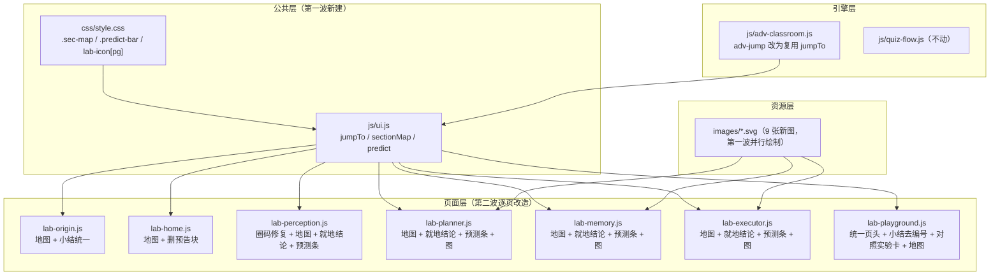

## 产品概述

对《AI 智能体互动教学系统（静态版）》（面向小学五年级的纯静态互动教学网页，含封面 + 七个实验室）按第二轮评审结论做第三轮修订，聚焦**教学逻辑收口、知识点闭环、动手前预测、开篇认知地图、图文均衡**五个方向。

## 核心功能

### 1. 教学逻辑收口（问题 1 / 问题 3）

- **L13 智能体实验室补强**：页头由手写改为全站统一页头（补副标题与胶囊标签）；「课堂小结」由编号卡改为不带编号的小结块，口径与其余六页一致；新增一张「全班对照实验」卡——A 组关记忆器 / B 组关规划器，同一问题先下注预测、两组分别作答、最后给出对比结果。
- **架构实验室**：删除页尾的「作品主线预告 + CTA」区块，让「课堂小结」成为页面最后一块。
- **起源实验室**：小结改为与其余六页一致的结构（核心结论 + 要点列表 + 课后思考），并带上起源语义色。
- 学习目标索引不做；L14–L16 为课堂展示环节，不进入网页。

### 2. 知识点就地闭环（教学内容）

四个组件页把页尾回顾清单中与各实验对应的条目，**回填到对应实验卡末尾**作为「就地结论」，让学生做完实验当场看到该记住什么；页尾整体回顾保留，措辞与就地结论错开。

### 3. 动手前先预测（互动方式）

四个组件页的正文实验卡统一加一条「预测条」：开跑前先选一个预测，跑完自动对照并提示是否猜中。仅改四个组件页正文卡，不改动进阶原理互动课堂那一层。

### 4. 开篇认知地图（展示方式）

七个板块各新增一张开篇「本节地图」，位于页头与学习目标之间，把本页主要卡片归为三到五组节点；**节点可点击 → 平滑滚动到对应卡片并高亮闪烁**，兼作页内导航。

### 5. 图文均衡（展示方式）

记忆器、规划器、执行器三页各新增 2–3 张自绘示意图（共约 9 张），采用「左图右解」双栏版式接入，与感知器已有的原理图版式保持同一套视觉语言。

### 6. 回归修复

修复上一轮引入的圈码溢出：记忆器第 21 张编号卡的徽章当前显示阿拉伯数字，需恢复为圈码形态。

## 视觉与交互效果

- 新增地图与预测条沿用既有设计系统（语义色、圆角、字号阶梯、`.adv-chip` / `.fb-ok` / `.fb-no` 反馈语言），不引入新框架。
- 九张示意图沿用项目自绘 SVG 风格（配色、字体、圆角、字号与 `inject-scene.svg` 一致），不出现与卡片标题重复的图内标题。
- 所有新增元素在脚本或图片加载失败时保持可见、不阻塞教学；窄屏下地图与左图右解版式自动回落单列。

## 技术栈

沿用项目现状，不引入任何新依赖、无构建步骤：

- 纯静态 HTML/CSS/JavaScript（原生 ES5 语法风格，模块以 `window.AgentLab` 命名空间挂载）
- 样式：单文件 `css/style.css`（含两代变量层，苹果风统一层在文件后段生效）
- 图形：手写 SVG（放在 `images/`），复用现有 `.ta-duo` / `.ta-image-wrap` / `.ta-image` / `.ta-source` 版式
- 验证：`node --check` 做语法校验 + `agent-browser` 做真实浏览器交互验收
- 后端服务：项目自带 `_start_bg.ps1`（PowerShell 静态服务器，端口 8124）

## 实现方案

### 总体策略：公共能力前移 + 逐页改造并行

本轮改动跨越 11 个文件，存在明显的共享文件冲突（`lab-perception.js` 同时承载全站公共实现与感知器页内容；`style.css` 被地图与预测条共同使用；`lab-memory/planner/executor.js` 同时被「就地结论」「预测条」「图片接入」三项触及）。因此采取**两波推进**：

- **第一波（5 个任务全并行，各自独立文件）**：圈码修复、公共组件三件套、三组 SVG 绘图。此波不产生文件交叉，可最大并行。
- **第二波（6 个任务并行，一个任务只改一页）**：把某一页需要的地图、就地结论、预测条、图片接入**合并进同一个任务**，从根本上消除同文件冲突。
- **收尾**：全站浏览器回归 + 文档同步。

### 关键技术决策

**决策 1：把「跳转高亮」抽成公共函数，而不是复制两份。**
现状 `js/adv-classroom.js:107-122` 的 `adv-jump` 已实现「按 id 找元素 → `scrollIntoView` → 加 `adv-flash` 闪烁」。新地图需要同一能力。若各自实现会出现两套行为不一致（滚动方式、高亮类名、降级处理）。故抽为 `AgentLab.UI.jumpTo(elId)`，并让 `adv-jump` 改为调用它。理由：DRY；同时新地图天然继承「元素不存在时安全返回」「`scrollIntoView` 异常时降级为原生滚动」的既有健壮性。

**决策 2：地图节点用「稳定锚点」定位，而非序号。**
`card()` 生成的卡片带 `data-card-num`（渲染期递增），但序号会随卡片增删而变，作为地图锚点不稳定。因此地图节点的目标一律使用**显式 `id`**：优先复用已有 id（如 `pc-inject-scene`），缺失的关键卡由本页改造任务补一个语义化 id。理由：地图文案与锚点解耦，后续增删卡片不会让地图指错位置。

**决策 3：预测条做成「前置记录 + 跑完对照」的松耦合组件，而不是改写各实验的跑动逻辑。**
四页正文实验卡实现方式各不相同（部分是自定义 `bind*`，部分是直接挂载交互类型）。若要求每个实验都回调组件，侵入性大、回归面广。故设计为：

- `U.predict({ id, q, opts, ans, why, hint })` 只负责渲染一个预测条（复用 `.adv-chip` 与 `.fb-ok`/`.fb-no`）并记录学生的选择；
- 每个实验在其「跑完」的位置调用一次 `U.predictResolve(id)`，组件自动展开对照结果。
- 该函数**幂等**（重复调用不重复展开），且实验若从不调用，预测条只停留在「已记录预测」状态，不报错、不阻塞。
理由：改动面可控（每个实验只加一行调用），且天然支持「分步推进 / 自动播放」等多形态实验。

**决策 4：圈码修复采用「扩展圈码表 + 保留数字兜底」。**
`CIRCLED` 当前只有 20 个（`js/lab-perception.js:1307`），而记忆器已有 21 张编号卡。修复为：把圈码表扩展到 30（`㉑`–`㉚`），并**保留** `|| String(idx)` 兜底。理由：扩展解决当前溢出；保留兜底保证将来任意页卡片数增长时不会出现空白徽章。同时需在浏览器中确认所选字体对 `㉑` 及以上的渲染效果，若字形不可用则改用「统一圆形徽章 + 数字」方案。

**决策 5：L13 语义色通过补 CSS 变体解决，而非内联样式。**
`labHead()` 输出 `<div class="lab-icon" data-color="xxx">`，而 `style.css:7793-7798` 只定义了 `per/plan/mem/exe/brain/ori` 六种，**没有 `pg`**。L13 当前用内联渐变绕过。修复为在 CSS 中补 `.lab-icon[data-color="pg"]`（变量 `--c-pg` / `--c-pg-deep` 已存在），然后 L13 改用统一 `labHead("pg", ...)`。理由：去掉唯一的内联样式硬编码，让页头口徑真正统一；同时不破坏其它六页。

### 性能与可靠性

- 新增地图与预测条均为**纯 DOM + 事件委托**，无轮询、无额外网络请求；地图节点数量级为 3–5，可忽略。
- 九张 SVG 为静态矢量资源，浏览器缓存后零成本；单张体积控制在 10KB 量级。
- 预测条与地图不写 `localStorage`，刷新后回到初始态，与当前项目「无状态」行为一致（本轮不引入状态持久化）。
- 所有新增能力遵循项目既有降级原则：脚本异常时不阻塞渲染，图片加载失败时不撑破版式。

## 实现要点（执行细节）

1. **编码陷阱**：`js/*.js` 为 GBK 编码，`search_content`（ripgrep）在其上会返回 0 命中，必须用 `read_file` 或 `Select-String -Encoding UTF8`；修改时保持原编码写入。
2. **卡片编号约定**：四个组件页的卡片标题**不得写手写圈码**，由 `numberCards()` 按渲染顺序自动编号；起源与架构两页仍是手写圈码，本轮不动其编号方式（除起源小结结构调整）。
3. **地图插入位置**：必须在 `labHead()` 之后、`.lesson-goal` 之前；`js/reveal.js:16` 的进场选择器当前不含地图容器，需把地图根元素类名补进该选择器（或在 CSS 中保证其默认可见），避免出现「进场后不显示」。
4. **架构页删块**：删除 `js/lab-home.js:859-885` 的区块与 `js/lab-home.js:897-898` 的事件绑定；删除后需确认 `bindAssembly/bindAssemble/bindQuick/bindDemoFlow/bindCases/bindQuiz/bindAdvClassroom/bindCbToc` 全部保留且无残留引用（该区块内对 L16 的引用随之消失，与「L14–L16 不改」不冲突）。
5. **起源小结改造**：原 4 条 `.ls-item` 重新组织——「关键公式」升级为 `.summary-core`；「L01 核心」「L02 核心」转为 `.summary-points` 条目；「下节课预告」并入 `.summary-points` 末条或 `.summary-think` 引导语；**必须新增一条真正的课后思考**。同时补 `card-ori` 类使 `style.css:8123` 的标题配色规则生效，改完需目视确认标题颜色不再是原紫色硬编码 `--c-ori-deep` 的冲突感。
6. **就地结论口径**：页尾 `.summary-points` 保留（作整页回顾），就地结论**换一套措辞**（例如页尾用「会维护：…」，就地用「小结：这条告诉我们…」），避免学生读到重复句子。
7. **预测条落点盘点**：需先按页列出「有明确跑动/推进/开关对照动作」的实验卡清单，只在这些卡上接入；纯讲解卡、纯排序卡、已是闯关型的卡不加（避免与答题引擎的反馈重复）。
8. **`.ta-duo` 版式约束**：`.ta-duo .ta-image` 限定 `max-height:515px; width:auto`，新绘 SVG 的 `viewBox` 宽高比必须按「在半栏宽度下文字仍清晰」设计（参考上一轮 `inject-scene.svg` 从 620×560 改为 460×500 的取舍），单栏宽度按约 460px 估算；`@media (max-width:900px)` 会自动回落单列，无需额外处理。
9. **SVG 风格硬约束**：不写图内头部标题（卡片标题已提供）；配色、字号、圆角、字体族严格对齐 `images/inject-scene.svg`；禁止外部图片、禁止脚本、禁止内嵌字体。
10. **影响面控制**：本轮不做拖拽、不做学生输出通道、不做难度星级、不做 Boundary 标注、不做状态落盘、不做标题改问句、不做深色模式与 ARIA、不改导航命名——这些均已在需求阶段明确排除，执行时不得顺手改动。

## 架构设计

本轮不改变系统架构，属于在既有分层上的增量扩展：



组件关系说明：

- **公共层**是最先落地的地基，被页面层与引擎层共同依赖，因此必须排在所有内容改动之前完成。
- **页面层**各页之间无依赖，可完全并行；唯一例外是感知器页必须等圈码修复完成（同一文件）。
- **资源层**（九张 SVG）只产出文件，不触碰任何 js/css，因此可与公共层完全并行；由规划器 / 记忆器 / 执行器三页的改造任务负责接入。

## 目录结构

```
AI智能体互动教学系统_静态版/
├── css/
│   └── style.css                    # [MODIFY] 新增三组样式：① .lab-icon[data-color="pg"]（L13 页头紫色变体）；
│                                    #   ② .sec-map / .sec-map-node 一组「本节地图」样式（含 hover 位移、当前态、
│                                    #      窄屏回落单列）；③ .predict-bar / .predict-opt / .predict-fb 一组
│                                    #      「预测条」样式（复用 .adv-chip 的视觉语言，与 .fb-ok/.fb-no 对齐）。
│                                    #   同时把地图根元素类名补进 js/reveal.js 的进场选择器（或在 CSS 中
│                                    #   声明其默认可见），避免进场动画导致地图不显示。
├── images/
│   ├── mem-lifecycle.svg            # [NEW] 记忆器：记忆的「五步一生」（编码→存储→检索→整合→遗忘），
│   │                                #   横向或纵向流程，整合一步用强调色突出「短期→长期」的跃迁。
│   ├── mem-levels.svg               # [NEW] 记忆器：记忆三层次（基础回忆 / 多会话检索 / 主动服务），
│   │                                #   阶梯式示意，每层标注「能做什么」与「难点在哪」。
│   ├── mem-scoreboard.svg           # [NEW] 记忆器：表 7-3 三种方案的分层成绩单（结构化记忆 / 纯 RAG /
│   │                                #   混合），三层柱状对比 + 总分，必须体现「混合并没有自然胜出」。
│   ├── plan-react-loop.svg          # [NEW] 规划器：ReAct 循环（思考→行动→观察→再思考→交付），闭环箭头。
│   ├── plan-checklist-vs-prose.svg  # [NEW] 规划器：一段话计划 vs 清单计划双轨对比，左栏中途卡住、
│   │                                #   右栏逐项打勾走完。
│   ├── plan-paradigms.svg           # [NEW] 规划器：Plan-and-Execute vs ReAct 两范式对比
│   │                                #   （先规划后执行 vs 边想边做）。
│   ├── exe-mcp-nm.svg               # [NEW] 执行器：MCP 把 N×M 收敛为 N+M（左杂乱连线、右星型接入）。
│   ├── exe-tool-taxonomy.svg        # [NEW] 执行器：工具五分类（感知 / 执行 / 协作 / 事件触发 / 用户沟通），
│   │                                #   五宫格 + 每类举一个本系统里的真实工具。
│   └── exe-function-calling.svg     # [NEW] 执行器：Function Calling 四步流程
│                                    #   （用户提问→模型输出 JSON 指令→程序执行工具→结果回填模型）。
├── js/
│   ├── ui.js                        # [MODIFY] 新增三个公共成员（挂在 window.AgentLab.UI 上）：
│   │                                #   · jumpTo(elId)：安全跳转 + 高亮闪烁（元素不存在时静默返回，
│   │                                #     scrollIntoView 抛错时降级为原生滚动）。
│   │                                #   · sectionMap({ title, hint, groups:[{label, items:[{t, el, note}]}] })：
│   │                                #     渲染「本节地图」HTML，节点带 data-jump 属性。
│   │                                #   · predict({ id, q, opts, ans, why, hint }) / predictResolve(id)：
│   │                                #     渲染预测条 + 记录选择 + 幂等地展开对照结果。
│   │                                #   用一次事件委托统一处理 [data-jump] 与预测条点击，避免逐页绑定。
│   ├── adv-classroom.js             # [MODIFY] 把 adv-jump 的点击处理改为调用 AgentLab.UI.jumpTo，
│   │                                #   去掉重复的滚动/高亮实现（行为保持不变）。
│   ├── lab-perception.js            # [MODIFY] ① 圈码修复：CIRCLED 扩展到 30 个（含 ㉑ 及以上），
│   │                                #      保留数字兜底；② 感知器页接入本节地图；③ 正文实验卡回填就地结论；
│   │                                #   ④ 正文实验卡接入预测条。注意：本文件同时是全站公共实现的宿主
│   │                                #      （labHead / card / numberCards / CIRCLED），改动需格外谨慎。
│   ├── lab-planner.js               # [MODIFY] 接入本节地图 + 回填就地结论（8 条要点对应到实验卡）
│   │                                #   + 正文实验卡接入预测条 + 接入 3 张规划器 SVG（左图右解版式）。
│   ├── lab-memory.js                # [MODIFY] 接入本节地图 + 回填就地结论（10 条要点）
│   │                                #   + 正文实验卡接入预测条 + 接入 3 张记忆器 SVG。
│   ├── lab-executor.js              # [MODIFY] 接入本节地图 + 回填就地结论（6 条要点）
│   │                                #   + 正文实验卡接入预测条 + 接入 3 张执行器 SVG。
│   ├── lab-origin.js                # [MODIFY] ① 接入本节地图；② 课堂小结由 .ls-* 结构改为
│   │                                #   .lesson-summary.card-ori + .summary-core + .summary-points
│   │                                #   + .summary-think，内容重组织并新增课后思考。
│   ├── lab-home.js                  # [MODIFY] ① 接入本节地图；② 删除「作品主线预告 + CTA」区块
│   │                                #   （约 859-885 行）及其事件绑定（约 897-898 行），使课堂小结
│   │                                #   成为页面最后一块。
│   └── lab-playground.js            # [MODIFY] ① 页头改用统一 labHead("pg", "robot", ...)；
│                                    #   ② 课堂小结由编号卡改为不带编号的 .lesson-summary；
│                                    #   ③ 新增「全班对照实验」卡（A 组关记忆 / B 组关规划，先预测后对比）；
│                                    #   ④ 接入本节地图。
└── README.md                        # [MODIFY] 同步本轮变更：七页新增地图、四页就地结论与预测条、
                                     #   L13 三项改动、架构页删块、起源小结口径、九张新图清单、
                                     #   以及圈码修复说明。
```

## 关键代码结构（新增公共契约）

以下三个成员是本轮新增的**唯一跨模块契约**，被 7 个页面共同依赖，需先定义清楚：

```js
/* js/ui.js —— 挂在 AgentLab.UI 上 */

/**
 * 安全跳转到指定元素并高亮闪烁。
 * @param {string} elId 目标元素 id；不存在时静默返回（不抛错）
 * 行为：scrollIntoView({behavior:"smooth", block:"start"})
 *      → classList.add("adv-flash")（复用既有 CSS 动画）
 *      → scrollIntoView 抛错时降级为无参调用
 */
function jumpTo(elId) { /* ... */ }

/**
 * 渲染「本节地图」。
 * @param {Object} opt
 * @param {string} opt.title  地图标题（如"本节地图：这一页要走的四步"）
 * @param {string} [opt.hint] 一句话导读
 * @param {string} opt.color  语义色：per / plan / mem / exe / brain / ori / pg
 * @param {Array}  opt.groups [{ label, items:[{ t:"节点文字", el:"目标元素id", note:"可选小注" }] }]
 * @returns {string} HTML 字符串（节点带 data-jump="目标id"，由事件委托统一处理）
 */
function sectionMap(opt) { /* ... */ }

/**
 * 渲染「预测条」并记录选择。
 * @param {Object} opt
 * @param {string} opt.id    本预测条的唯一 id（同页内不可重复）
 * @param {string} opt.q     预测问题
 * @param {Array}  opt.opts  [{ k:"选项键", t:"选项文案" }]
 * @param {string} opt.ans   正确选项的 k
 * @param {string} opt.why   答对时的解释
 * @param {string} [opt.hint] 答错时的提示
 * @returns {string} HTML 字符串
 */
function predict(opt) { /* ... */ }

/**
 * 实验跑完后调用，展开「你猜对了吗」对照结果。幂等：重复调用不重复展开。
 * @param {string} id predict() 传入的同一个 id
 */
function predictResolve(id) { /* ... */ }
```

设计约束：`sectionMap` 与 `predict` 只产出 HTML，不在渲染期绑定事件；点击统一由 `ui.js` 在模块初始化时通过一次 `document` 级事件委托处理（与现有 `U.term()` 术语折叠的做法保持一致），避免每次页面重渲染都要重新绑定。

## Agent Extensions

### SubAgent

- **code-explorer**
- 用途：在第一波与第二波开工前，用它精确盘点四页正文实验卡中「有明确跑动/推进/开关对照动作」的卡片清单、每张卡可用的稳定锚点 id 现状（哪些已有、哪些需补）、以及各页 `.summary-points` 条目与承载卡的对应关系。
- 预期产出：三份清单——① 预测条落点清单（按页给出卡片名 + 该卡跑完的代码位置）；② 地图锚点清单（按页给出建议节点与其目标 id，标明需新增 id 的卡片）；③ 就地结论映射表（页尾要点条目 → 归属实验卡）。

### Skill

- **light-figure-drawing**
- 用途：绘制记忆器 / 规划器 / 执行器三页共 9 张示意图。严格按 `images/inject-scene.svg` 与 `images/ocr-pipeline.svg` 的配色、字体族、字号、圆角规范产出纯手写 SVG，保证「图注即结论」「图先于文字」的看图习惯。
- 预期产出：9 个通过标签平衡校验、可在浏览器正常加载（`naturalWidth` 非 0）、在半栏宽度下图内文字仍清晰可读的 SVG 文件。
- **light-consistency**
- 用途：在九张新图与七个页面之间统一视觉与术语——语义色不得串用（记忆绿 / 规划橙 / 执行红）、同一概念在全站的叫法与其他三张图的口径一致（如"感知器/规划器/记忆器/执行器"、"内容 vs 指令"），避免本轮新增内容与前两轮成果出现说法冲突。
- 预期产出：一份一致性核对结论 + 若有偏差则给出对齐后的文案或配色修正。
- **agent-browser**
- 用途：全程真实浏览器验收。逐页打开 `http://127.0.0.1:8124/index.html`，验证地图节点点击能定位并高亮、预测条可选并能正确对照、就地结论出现在对应实验卡末尾、九张新图加载成功、L13 页头与小结口径一致、架构页小结成为页尾、起源小结结构与其余六页一致、记忆器第 21 张卡圈码恢复正常；并截图留证。
- 预期产出：覆盖上述全部验证项的实测结果与关键截图，确保无白屏、无 JS 报错、窄屏版式正常回落。