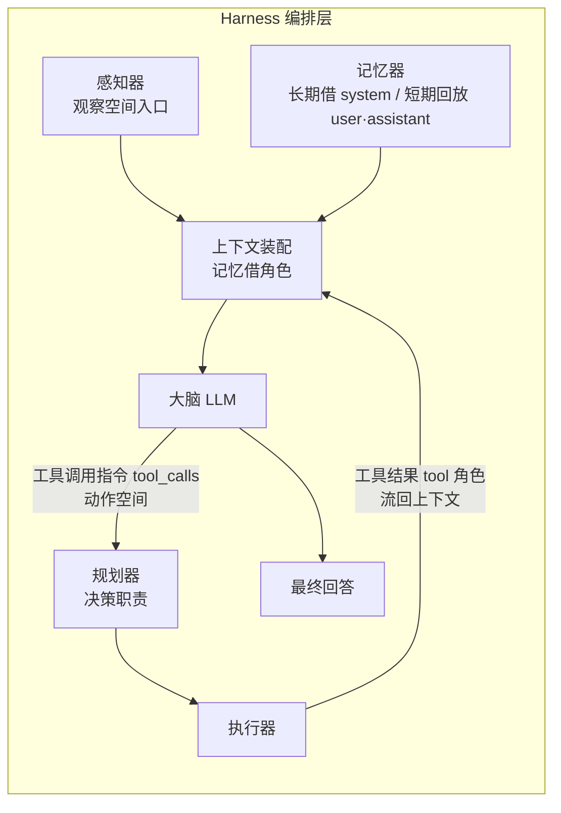

## 需求概述

把「智能体实验室」（L13）里的实战演示体「智能体小管家」重新设计为符合「四组件模式」的智能体：**大脑（LLM）居中，感知器 / 规划器 / 记忆器 / 执行器四大组件环绕协作**。总装图与信息流必须按真实运行轨迹绘制，明确区分观察空间与动作空间，并交代记忆是"借用了哪个角色"进入上下文的。

## 核心问题

- 总装图口径自相矛盾：架构实验室首页已是"大脑居中 + 四大组件"，而智能体实验室把规划器画成"大脑的 thinking 模式"，两页打架。
- 信息流未按真实轨迹绘制：看不出感知器→上下文、记忆借 system 身份、规划器→动作（tool_calls）、执行器→tool 结果回流这条链。
- 规划器与思考模式被焊死：开关名叫"规划器"，实际改的是模型 thinking 参数。
- 示例全是单工具单轮问题，规划器的拆解/排序/条件分支无从体现。

## 核心功能

- **口径统一（全站）**：规划器 = Agent 的决策职责（独立组件，每轮参与，产出属于动作空间）；思考模式 = 大模型能力开关（决定推理过程 reasoning_content 是否显式可见，可开可关）。关掉思考模式只是"看不见规划"，不是"规划停止"。
- **总装图重绘**：规划器成为独立有向组件（大脑 ↔ 规划器 → 执行器），标注观察空间入口与动作空间出口。
- **信息流按轨迹重绘**：逐轮展示每块上下文借的角色（长期记忆借 system、短期记忆回放为 user/assistant、工具结果走 tool），并标注观察空间 / 动作空间。
- **机制解耦**：新增真实的"关规划器"语义——关掉后剥夺模型自主选工具的决策权，改由本地规则代劳决策（名实相符）；思考模式独立成开关。
- **复杂示例**：至少一个多步任务，体现拆解、排序、条件分支、多次工具调用与记忆参与，既可离线一键重放（不依赖 API Key），也放进输入建议供真机提问。

## 视觉效果

总装图保持现状的放射状美学与配色，但规划器由"无箭头静态连线"变为独立有向组件；信息流新增"角色标签 + 所属空间（观察/动作）"双标注；新增的复杂示例以分步点亮的轨迹动画呈现，每一步同时高亮对应组件、角色与空间。整体风格与现有教学站点一致。

## 技术栈选择

沿用项目现状，不引入任何新依赖：

- 形态：**纯静态站点**（`index.html` + `js/*.js` + `css/style.css`），无构建、无框架，模块以 IIFE 挂载到 `window.AgentLab`。
- 语言：原生 JavaScript（ES5 风格为主，已有文件大量使用 `var` / `function`）+ HTML + CSS。
- 复用现有能力：
- `AgentLab.Adv.types.race`（`demoHTML` / `bind`）——已有的离线「双轨并排推进」演示引擎，可直接承载复杂示例的离线重放。
- `AgentLab.Agent.run(text, history, hooks)`——真机运行通道，hooks 已含 `onEngine / onStage / onThink / onPlan / onObserve / onStop / onContext / onTool / onPayload`。
- `AgentLab.LabPerception.card(...)`、`AgentLab.UI.icon/esc`、`AgentLab.Store.getTools/getClassInfo`——页面与数据装配的既有范式。

选择理由：本项目是课堂静态课件，需求是"改造既有页面与既有运行逻辑"，引入框架/构建会破坏"双击即用、可离线分发"的部署方式，属负收益。

## 实现方案

分四块推进，彼此解耦：

### 1. 术语与机制定稿（口径 + 机制双改）

- 新增独立开关 `flags.thinking`（思考模式，默认 **关**），与既有 `flags.planner`（规划器）**彻底分离**。
- `flags.planner = true`（默认）：模型自主决策——`tool_choice: auto`，由模型读工具说明书自己判断要不要调工具、调哪个。
- `flags.planner = false`：**剥夺模型自主决策权**——不再让模型选工具，改由本地规则引擎（复用 `runRules` 的规划路径）判定并强制指定工具；模型的职责降级为"只负责把结果组织成人话"。这正好与既有"关规划器 = 不知道要分几步做、直接把话丢给工具/参数凑不齐"的课堂说法对齐。
- `flags.thinking` 仅控制 `body.thinking`（enabled / disabled），文案统一为"思考过程可不可见"。
- 引擎分流改为：有 Key 且规划器开 → `runLLM`；有 Key 但规划器关 → 新增 `runPlannedByRules`（规则做规划 + LLM 作答）；无 Key → 既有 `runRules` 降级。

### 2. 总装图与信息流重绘（UI）

- 把 `brain-plan` 从 `.is-static`（无箭头实线）改为**真实有向边**，并新增 `plan-exe` 边（规划器 → 执行器，体现"想完就去调"）。由于 `n-plan` 节点与底部定位在 CSS 中已存在，仅需改边的样式与新增定位规则，改动面小。
- 信息流（`pg-chain` / `pg-rounds`）新增两处标注：每块上下文的**角色**（system / user / assistant / tool）与**所属空间**（观察空间 / 动作空间）；assistant 带 tool_calls 的那条明确标"动作空间"。
- 总装图注解替换为："规划器＝大脑的决策职责（独立组件，每轮参与，产出是动作）；思考模式＝推理过程可不可见（模型开关，可开可关）。"

### 3. 复杂示例（两者都要）

示例任务（多步 + 条件分支 + 多次工具 + 记忆）：

> 「我们班明天要去杭州春游，帮我看看明天会不会下雨；要是下雨就提醒我带雨伞，再算一下 3 瓶 12 元的果汁和 2 包 8 元的面包一共多少钱。」
> >
> （演示前先问一句"我住在杭州"，让短期记忆参与，体现记忆借 user 角色回放。）

规划器的作用点：拆成 3 个子任务（查天气 / 设提醒 / 算总价）；排序与条件依赖（"设提醒"依赖"查天气"的结果）；参数构造（city=杭州、dateKey=明天、算式 3*12+2*8=52）。执行器至少调用 2 次（weather_query、calculator，可能 3 次含 reminder_set）。

- 离线重放：以静态数据描述完整多轮轨迹（每步含组件、角色、所属空间、内容），点一下逐步骤点亮，不依赖 API Key。
- 真机提问：同一条加进 `SUGGESTIONS` 芯片，走 `AgentLab.Agent.run` 真实跑。

### 4. 全站口径统一

以定稿术语为准，逐处核对并改写 `lab-playground.js`、`lab-planner.js`、`lab-home.js`、`lab-perception.js`、`config.js`、`api.js` 中涉及"规划器 / 思考模式 / 记忆借角色"的表述，确保零冲突。

## 关键技术决策与理由

- **为什么把"关规划器"落到"规则代劳"而不是"直接报错"**：既有 `runRules` 已是成熟路径，且课堂实验"A 组关记忆 / B 组关规划，两组都卡但断点不同"本来就建立在"规则代劳"的语义上；复用它可以让开关名实相符，且不新增不稳定代码。
- **为什么思考模式要独立且默认为关**：`api.js` 的 `disableThinking` 已确立"默认不思考、直接决策"的基线；把它独立出来后，"关掉规划器"与"关掉思考"两个课堂操作才互不污染，学生能分别看到两种不同后果。
- **为什么复用 `race` 引擎做离线重放**：避免为示例再造一套动画与状态机，符合 DRY；且 `race` 已支持"走一步 / 一次走完 / 重来"，与"逐步看清规划器作用"的教学诉求天然匹配。
- **性能与可靠性**：全部为本地 DOM 操作与静态数据，无网络请求（真机路径除外）；离线重放零 I/O，页面体量增量可忽略。真实路径保留既有的 thinking 参数 400 兜底重试逻辑。

## 架构设计



- 组件关系：大脑居中；感知器 → 上下文；记忆器借角色 → 上下文；规划器产出动作 → 执行器；执行器结果以 tool 角色回流 → 下一轮。
- 改动集中在 `lab-playground.js`（图与信息流）、`agent.js`（机制）、`config.js`（提示词）、`style.css`（边样式），其余为口径文案。

## 目录结构

```
AI智能体互动教学系统_静态版/
├── js/
│   ├── agent.js            # [MODIFY] 机制解耦核心。拆分 flags.thinking 与 flags.planner；callBrain 只按 thinking 决定 body.thinking、不再与规划器耦合；新增「规划器关闭 → 规则代劳决策（规则定工具 + LLM 作答）」的运行路径；重写 onStage("planner")、onThink 的文案与字段（thinkingOn 取自 flags.thinking，新增 plannerOn / isRules 区分）；run() 的引擎分流相应调整。
│   ├── config.js           # [MODIFY] buildSystemPrompt：补一条明确的多步规划指令（多步任务先拆解、排顺序、逐步调工具、拿到结果再决定下一步）；四大组件口径句改写，明确"规划器是决策职责、思考模式是能力开关"；保留既有 classInfo/manual/时间注入逻辑。
│   ├── lab-playground.js   # [MODIFY] 总装图：brain-plan 改真实有向边、新增 plan-exe 边、替换 pg-hub-note 文案；信息流：pg-chain/pg-rounds 每块增加"角色 + 所属空间（观察/动作）"标注；新增复杂示例的离线重放演示块与 SUGGESTIONS 芯片；同步 STAGE_EDGES / REACT_OWNER / 小结文案口径。
│   ├── lab-planner.js      # [MODIFY] 口径核对：CoT / 思考模式相关卡补一句"它是规划器可用的一种想清楚手段，不是规划器本身"；ReAct 与工具选择决策卡与新口径对齐。
│   ├── lab-home.js         # [MODIFY] 口径核对：总装图/拼装/拆解四问表述与 playground 完全一致（本页口径已基本正确，主要是核对与微调）。
│   ├── lab-perception.js   # [MODIFY] 口径核对：消息四角色卡、思考模式开关 note、观察/动作空间卡与 pg-chain 口径对齐。
│   └── api.js              # [MODIFY] 仅文案核对：disableThinking 注释与思考模式提示语同新口径一致（逻辑不动）。
├── css/
│   └── style.css           # [MODIFY] .pg-hub：brain-plan 改为有向流动边（复用既有 is-on 动画与 --edge-c-on），新增 plan-exe 边定位；移除/改造 .is-static 语义；新增信息流"角色 + 空间"标签样式（复用现有 pill-* 语义色）。
└── index.html              # [可选修改] 若新增演示块需容器，按现有约定追加（预计无需改动，优先在 JS 内注入）。
```

## 关键代码结构

开关与 hooks 契约（接口级，供各文件对齐）：

```js
// agent.js —— 开关分层（新增 thinking，与 planner 解耦）
var flags = { perception: true, planner: true, memory: true, executor: true, thinking: false };

// run() 引擎分流语义
//   有 Key 且 flags.planner  -> runLLM(...)              // 模型自主决策（tool_choice: auto）
//   有 Key 但 flags.planner 关 -> runPlannedByRules(...)   // 规则定工具 + LLM 作答（真实"关规划器"）
//   无 Key                    -> runRules(...)            // 既有降级

// 与 UI 的契约（向后兼容，新增字段不改旧字段含义）
// onThink({ round, text, thinkingOn, plannerOn, isRules })
// onStage("planner", "…（规划器=决策职责；思考过程：可见/不可见）", null, round)
```

离线复杂示例的轨迹数据结构（新增，供重放渲染）：

```js
// lab-playground.js —— 复杂示例的离线轨迹（每步标明组件 / 角色 / 所属空间）
var PG_COMPLEX_DEMO = {
  task: "我们班明天要去杭州春游，帮我看看明天会不会下雨；要是下雨就提醒我带雨伞，再算一下 3 瓶 12 元的果汁和 2 包 8 元的面包一共多少钱。",
  steps: [
    { stage: "perception", space: "observe", role: "user",      t: "把同学的请求整理成一条 user 消息" },
    { stage: "memory",     space: "observe", role: "system",    t: "长期记忆借 system 角色：班级知识库随规则一起给" },
    { stage: "planner",    space: "act",     role: "assistant", t: "拆成 3 步并排序：先查天气 → 按结果决定是否设提醒 → 另外算总价" },
    { stage: "planner",    space: "act",     role: "assistant", t: "第 1 轮动作：调用 weather_query(city=杭州, dateKey=明天)" },
    { stage: "executor",   space: "observe", role: "tool",      t: "天气工具返回：杭州 明天 小雨" },
    { stage: "planner",    space: "act",     role: "assistant", t: "第 2 轮：据结果决定再调 reminder_set(带雨伞) 与 calculator(3*12+2*8)" },
    { stage: "executor",   space: "observe", role: "tool",      t: "两个工具的结果回流到上下文" },
    { stage: "brain",      space: "act",     role: "assistant", t: "汇总结论：明天下雨要带伞，总价 52 元" }
  ]
};
```

## 实施注意

- **性能**：全部改动为本地 DOM 与静态数据，无 N+1/重复遍历问题；重放动画复用 `race` 引擎的既有节流与步进逻辑，不新增定时器。
- **日志/文案**：所有新增文案不得出现"规划器等于思考模式"的表述；涉及 `reasoning_content` 的说明统一为"推理过程的可见性"。
- **影响面控制**：`flags.thinking` 新增不得改变 `flags.planner` 的既有对外语义；真机路径保留 thinking 参数被 400 拒绝后的剥除重试逻辑，确保"关思考"这一课堂动作不会让整轮失败。`runPlannedByRules` 为新增路径，不改动 `runRules` / `runLLM` 现有行为。不删除 `.codebuddy` 目录。
- **回归风险点**：A/B 对照实验（关记忆 / 关规划）的结论文字、组件开关 UI（4 个开关）、`REACT_OWNER`、课堂小结——这些地方的"关规划器"后效必须与新机制一致（关规划器 = 不会拆步/参数凑不齐）。

## 设计目标

在现有教学站点视觉语言（暖底色 + 语义色 + 卡片式）之内，重绘「智能体内部工作台」的总装图与信息流，使"大脑居中 + 四大组件环绕"一眼可读，信息流按真实轨迹可追溯。

## 总装图（放射状，保持既有美学）

- 中心节点：大脑（LLM），实心描边 + 柔光外环，作为决策内核。
- 四周节点：感知器（上，进入）→ 大脑；记忆器（左，双向）；执行器（右，双向）；**规划器（下）改为独立有向组件**——大脑与规划器之间为流动虚线箭头（不再是无箭头实线），并新增"规划器 → 执行器"的斜向连线，直观表达"想完就去调"。
- 每条边沿用虚线流动 + 点亮的既有动画，颜色沿用组件语义色（感知器蓝、规划器橙、记忆器绿、执行器红、大脑金）；未参与本轮为虚线淡化态。
- 图内只放图标，名称留在图例行；注解区新增一句口径说明，不加重图内文字。

## 信息流（按轨迹逐轮展开）

- 每轮一个轮次标记（↻ 第 N 轮），下方按真实顺序列出"发给大脑的上下文"分块。
- 每块加两枚标签：**角色**（system / user / assistant / tool）与**所属空间**（观察空间 / 动作空间）。system 与 tool 标"观察空间"（信息进来）；assistant 带 tool_calls 标"动作空间"（决定要做的事）。
- 记忆分块注明来源身份：长期记忆"借 system 进来"、短期记忆"按 user/assistant 原样回放"；工具结果明示"执行器产物，走 tool 角色"。
- 新增"复杂示例"区块：点"逐步演示"逐步骤点亮组件与对应信息块，一步一说明；支持"一次走完 / 重来"。

## 交互与响应式

- 悬停节点高亮其相连边；点击图例行可定位到对应轨迹段落。
- 窄屏下纵向间距收紧、节点图标缩小，保持放射结构不塌陷；动效遵循 prefers-reduced-motion 关闭。
- 微动效：边流动、节点点亮缩放、示例步骤卡片依次浮现，均保持轻量、不打断阅读。

## Agent Extensions

### SubAgent

- **code-explorer**
- Purpose: 以 "very thorough" 级别全站排查所有涉及"规划器 / 思考模式 / 记忆借角色 / 总装图 / 信息流"的代码位置与文案，产出精确的待改清单（文件 + 行号 + 现状表述 + 目标表述）。
- Expected outcome: 一份可核对的清单，覆盖 `lab-playground.js`、`lab-planner.js`、`lab-home.js`、`lab-perception.js`、`agent.js`、`config.js`、`api.js`、`style.css`，无遗漏项与误报。

### Skill

- **light-backend-coding**
- Purpose: 编写 `agent.js` 的机制解耦与新增运行路径（`flags.thinking` 拆分、`runPlannedByRules` 规则代劳决策、hooks 契约调整），保证逻辑清晰、安全、可读、可维护。
- Expected outcome: 解耦后的运行逻辑通过自测，开关名实相符，"关规划器"与"关思考"两种课堂操作产生不同且正确的可见后果。
- **light-frontend-design**
- Purpose: 设计并实现总装图与信息流的新视觉（规划器独立有向边、角色 + 所属空间双标注、复杂示例分步动画），与现有站点风格统一且有视觉记忆点。
- Expected outcome: 重绘后的总装图与信息流在桌面与窄屏下均清晰美观，规划器一眼可见为独立组件。
- **light-consistency**
- Purpose: 建立并执行全站术语一致性检查，确保"规划器 = 决策职责""思考模式 = 推理可见性""记忆借角色"在所有页面表述零冲突。
- Expected outcome: 全站术语与视觉风格一致，无自相矛盾表述。
- **light-self-review**
- Purpose: 收尾自检逻辑漏洞、口径冲突、表述不统一、动效可读性与改动回归风险。
- Expected outcome: 交付前完成一轮自审并修正，改动不破坏既有实验与交互。