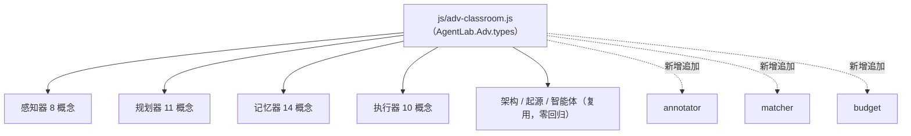

## 产品概述

对 AI 智能体互动教学系统（静态版）中「感知器、规划器、记忆器、执行器」四个实验室末尾的「进阶原理互动课堂」模块逐页审查，指出问题并落地优化。该模块是七个板块共用的教学组件：左侧概念导航，右侧按「一句话 / 打个比方 / 真实系统 / 动手做 / 自检一问 / 一键跳回对应实验」呈现，每个概念配一个动手实验。

## 核心功能

- 逐页审查四个进阶模块，输出改进意见：覆盖知识准确性（技术表述、跨页术语与数量口径一致、与 README 对齐）与交互闭环 / 防重复（补齐"观察→动作"闭环、差异化重复的滑条与向量地图实验）。
- 在向后兼容前提下增强共享引擎：新增可复用交互类型、既有类型的可选能力与容错，不改变现有类型对外行为。
- 按改进意见优化四个页面的概念文案与实验数据：修正 tile/patch 图像口径、补齐观察项与动作的呼应、统一停止条件口径、把重复同款的实验替换为形态不同的交互、把"识别类"任务从"点按钮"升级为"在真实材料上标注"。
- 同步更新说明文档，保持交互类型清单、各实验室进阶模块描述与实际一致。
- 保持既有教学主线、视觉风格与跳转关系不变，仅做内容与交互层面的完善。

## 技术栈

- 复用现有纯静态技术栈：原生 HTML + CSS + ES5 JavaScript，无框架、无构建步骤，保证 `file://` 双击可用。
- 交互全部为 DOM 事件驱动，视觉语义色沿用各板块 color（per / plan / mem / exe），样式集中在 `css/style.css`。
- 不改动网络能力（DeepSeek / 硅基流动）与既有实验逻辑，仅动「进阶原理互动课堂」相关内容与共享引擎的追加式能力。

## 实现方案

- **数据驱动，引擎与内容分离**：`js/adv-classroom.js`（`AgentLab.Adv`）负责结构与交互类型，四个 `lab-*.js` 只声明概念与实验数据。本次改动严格遵守该边界，页面侧只改数据与文案。
- **引擎追加式扩展（核心决策）**：新增 3 个可复用交互类型，仅"追加"到 `AgentLab.Adv.types`，既有 12 个类型的 `demoHTML/bind` 对外行为保持不变，因此同时使用该引擎的架构 / 起源 / 智能体三个板块零回归。
- `annotator`：在真实材料（网页正文 / 调用日志 / 用户原话）上点选目标片段，逐条即时判定并给出解释——把"识别类"任务从按钮列表升级为真实标注，直接服务"交互闭环"。
- `matcher`：左右两列卡片配对（左：实例 / 场景，右：分类 / 结论）——替换部分连续出现的 decider / picker，增加形态变化。
- `budget`：上下文预算分配器，把窗口预算分配给「系统提示词 / 知识片段 / 对话轨迹 / 当前问题」，实时显示总量占用与溢出提示——替换记忆器里与感知 / 规划重复的第 3 个滑条。
- **既有类型的兼容增强（可选能力，默认行为不变）**：
- `vectorMap` 新增可选 `threshold`（相似度门槛滑条）：用于区分感知器 `embed`（语义相近）与记忆器 `vec`（检索命中 + 门槛/召回），不传 `threshold` 时行为与现在完全一致。
- `modality` 的 `defaultKey` 容错：当默认键不在 `map` 中时回退到第一个选项，避免面板空白。
- `tuner` 的 `best` 自测延迟到用户真正拖动过一次后再出现，与"拖一圈之后判断"的文案一致。
- **性能与可靠性**：引擎仍遵循"只渲染当前概念的实验 DOM"策略，切换概念时才重建，避免一次性生成大量节点；新增类型复用现有 CSS 类与 `U.icon/esc/toast/celebrate`，不新增外部资源与网络依赖。`annotator` 使用字符串片段分片渲染，规模为教学级（个位数量级片段），无性能风险。

## 实现说明（执行细节）

- **必须用 ES5 语法**（`var`/`function`/`forEach`/`querySelectorAll`），禁止箭头函数、模板字符串、`const/let`——这是全站约束，`file://` 兼容所系。
- **不改既有类型行为**：`types` 只能新增键；`panelHTML`/`bind`/`contentHTML` 的既有分支保持兼容。
- **跳转关系已核验**：四个进阶模块内所有 `links[].el` 目标 id 均真实存在（含 `pc-*`/`mem-*`/`exe-*`/`pl-*`/`pg-*`，其中 `pg-` 为历史命名但仍在同一页面内），本次调整不得引入新的失效 id。
- **语义色跟随**：实验内高亮色由 `data.color = opt.color` 注入，新类型必须读取该字段，保证四页配色与所属板块一致。
- **降级不变**：`reveal.js`、`prefers-reduced-motion`、无 Key 走示例演示等既有降级路径不受影响。

## 架构设计



- 分层：引擎层（结构 + 交互类型 + 通用检查表 + 有 Key/无 Key 降级）→ 页面数据层（概念数组 + 类型映射 + 实验数据）→ 样式层（`css/style.css`）。
- 数据流：`page.bind` 调用 `AgentLab.Adv.bind(root, {concepts, color})` → 引擎渲染左导航与右面板 → 点击概念切换 `types[demo]` 生成的实验 → 互动仅更新自身局部 DOM。

## 目录结构

```
AI智能体互动教学系统_静态版/
├── js/
│   ├── adv-classroom.js   # [MODIFY] 共享引擎。追加 3 个类型：annotator（材料标注判定）、matcher（左右配对）、budget（上下文预算分配器）；为 vectorMap 增加可选 threshold、modality 增加 defaultKey 容错回退、tuner 的 best 自测延迟到首次拖动后。所有改动向后兼容，不改变既有 12 个类型的对外行为，保持 ES5。
│   ├── lab-perception.js  # [MODIFY] 感知器进阶模块。修正 ADV[0].real 与 ADV_MULTI_QUIZ[1].why 的 tile/patch 口径；ADV_OBS/ADV_ACTS 补齐"观察→动作"闭环（新增需 mood 的动作并注明"拿到≠该用"）；ADV[4].embed 链接文案与目标对齐（pc-token-input 实为 Token 切分）。
│   ├── lab-planner.js     # [MODIFY] 规划器进阶模块。统一 stop.best.why 口径与 compute 峰值（12 轮）；paradigm 由 decider 改为 matcher（场景↔范式），打破 cot/paradigm 连续 decider；ctx 增加"为何本页再看一次上下文窗口"的差异化说明。
│   ├── lab-memory.js      # [MODIFY] 记忆器进阶模块。修正 L682 分段注释（10 概念→14 概念）；ctxwin 由 squeezer 改为 budget（差异化第 3 个滑条）；vec 由 vectorMap 启用 threshold 并改写为"检索命中 / 门槛"视角；formats、cogsci 由 decider 改为 matcher，打散连续 decider；privacy 由 picker 改为 annotator（在用户原话上标注需脱敏字段）。
│   ├── lab-executor.js    # [MODIFY] 执行器进阶模块。five 由 picker 改为 matcher（工具↔五分类，与主卡 11 工具口径一致）；hallu 由 picker 改为 annotator（在调用日志上标注幻觉）；desc 与 gov 两个 sandbox 的分区标题与提示差异化。
│   └── （其余 lab-*.js 不动，回归验证零影响）
├── css/style.css          # [MODIFY] 为 annotator（可点选片段高亮/判定态）、matcher（左右两列与配对连线/选中态）、budget（分段预算条与溢出告警）补充样式，复用现有设计变量与配色，移动端可换行。
└── README.md              # [MODIFY] §7.2「内置 12 种可复用交互类型」更新为 15 种并补 annotator/matcher/budget 说明与 vectorMap 可选门槛；§四各实验室进阶模块描述同步（交互形态替换、记忆器 14 概念口径）。
```

## 关键代码结构（新增类型的数据契约）

```js
/* annotator：在真实材料上点选目标片段后逐条判定
 * data = { title, hint, icon, material:[{text, ok, why}], taskLabel,
 *          checkLabel, empty, passHtml, failHtml, resetLabel } */
AgentLab.Adv.types.annotator = { demoHTML: function (d) {}, bind: function (host, d) {} };

/* matcher：左右两列配对
 * data = { title, hint, icon, leftTitle, rightTitle, left:[{id,label,why}],
 *          pairs:{"leftId":"rightId"}, checkLabel, empty, passHtml, failHtml } */
AgentLab.Adv.types.matcher = { demoHTML: function (d) {}, bind: function (host, d) {} };

/* budget：上下文预算分配器
 * data = { title, hint, icon, capacity, parts:[{id,label,color,hint,def,min,max}],
 *          unitWord, overHtml, okHtml, note } */
AgentLab.Adv.types.budget = { demoHTML: function (d) {}, bind: function (host, d) {} };
```

## Agent Extensions

### Skill

- **light-consistency**
- Purpose: 在四个进阶模块与 README 之间统一术语、概念数量口径、命名与描述，避免跨页出现"同一概念两种叫法""数量对不上""文案与目标不符"。
- Expected outcome: 四页与 README 的术语、数量、交互类型清单完全一致，跨页重复实验的差异化说明清晰可读。
- **light-self-review**
- Purpose: 收尾阶段对四个进阶模块与共享引擎做自动自查，检查是否有逻辑漏洞、事实/口径错误、失效跳转、回归风险与不一致处。
- Expected outcome: 形成一份自检结论，确认 ES5 合规、既有 12 类交互零回归、其余三个板块进阶课堂不受影响、无新增失效 id。